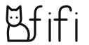

<p align="center">
  <picture>
    <source media="(prefers-color-scheme: dark)" srcset="assets/fifi-logo-dark.svg">
    
  </picture>
</p>

# fifi

fifi is a Rust inference engine for local coding agents.
It runs on Apple Silicon (MLX and Metal) and NVIDIA CUDA.
The `enginesrv` binary serves an OpenAI-compatible `/v1/chat/completions` route with streaming and tool calls.
One process can hold several engines. The shared memory plan and prefix reuse are in progress.

This is not a finished product. The model list below states where each family stands.

## Models

"Supported" means that the model passes its gates through `enginesrv`. No model is in that state yet.

- `Qwen/Qwen3.8-Flash-Next`, experts streamed from SSD, Apple Silicon: in progress.
- `Qwen3.6-35B-A3B`, resident on Apple Silicon: in progress.
- `Qwen3.6-35B-A3B`, CUDA: in progress. Only the model load works so far.
- `Mellum2.1-12B-A2.5B`, CUDA: in progress.
- `Qwen3.8-27B`: planned.

Weight formats:

- MLX affine and oQ safetensors, with the quantization read from the checkpoint metadata.
- GGUF F16, Q4_K, Q6_K, and Q8_0. Q5_0 is in progress and is not in `main`.

## Build

The crate is in `engine/`. The default build is portable.

```sh
cd engine
cargo build --release --bin enginesrv
cargo test
```

Two features select a backend.

- `native-mlx` builds the MLX adapter. It needs Apple Silicon macOS and the Metal toolchain.
  `native-ane` adds the optional ANE decision head.
- `native-cuda` builds the CUDA backend with `nvcc`. It needs Linux.

Start the server with `enginesrv --config <path>`.

## HTTP contract

- [api/openapi.yaml](api/openapi.yaml) is the HTTP contract that `enginesrv` serves.

## License

The Apache License 2.0 covers fifi. See [LICENSE](LICENSE).
Third-party notices are in [THIRD_PARTY_NOTICES.md](THIRD_PARTY_NOTICES.md).

## Source code

The repository is private.

```sh
git clone git@github.com:zbrdc/fifi.git
```

## Security problems

Report security problems privately to the maintainer, Dan Campos. Do not open a public issue.

## Credits

[THIRD_PARTY_NOTICES.md](THIRD_PARTY_NOTICES.md) lists the copied and derived third-party code that it covers.
The vendored `mlx-sys` and `safetensors` crates keep their own licence files in `engine/vendor/`.

The crate is still named `inference-engine`. The product name `fifi` arrived later, and the crate keeps its old name for now.
